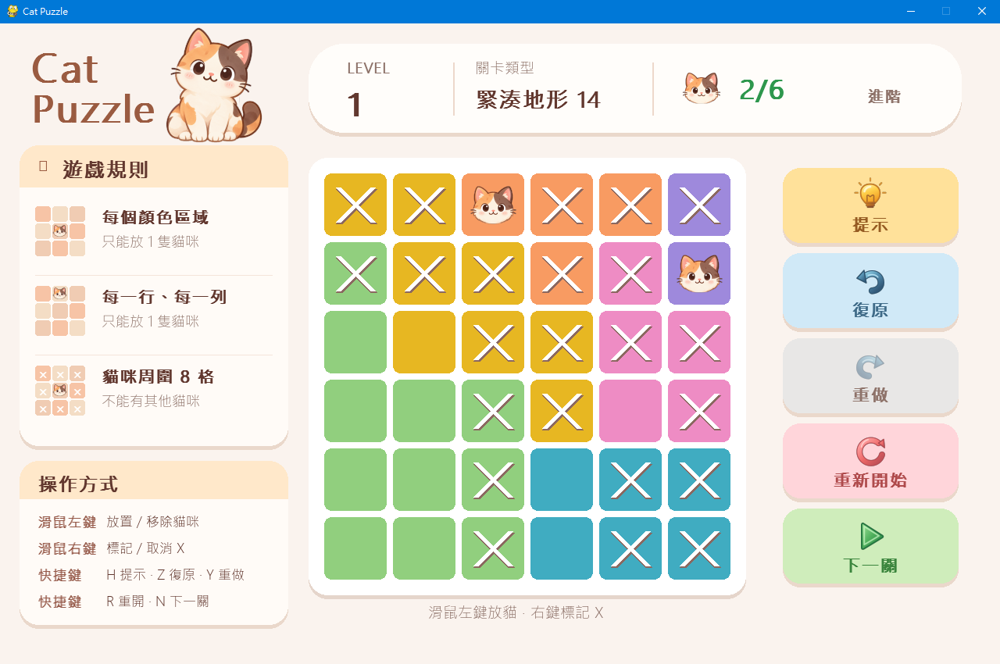
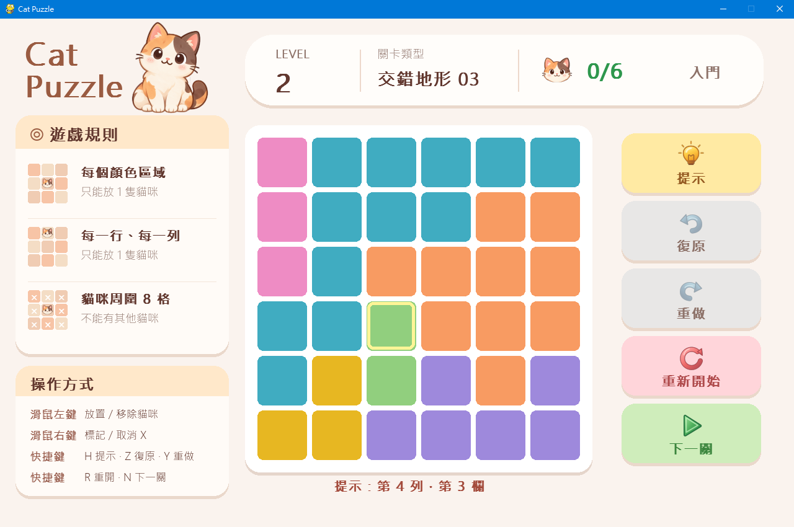

# Cat Puzzle | Python Logic Puzzle Game

使用 **Python、NumPy、Pygame** 與物件導向程式設計（OOP）開發的貓咪邏輯拼圖。玩家必須根據行、列、顏色區域與八方向相鄰限制，在 6×6 棋盤上正確放置貓咪。

**作品重點：** 150 關獨立版型、唯一解驗證、關卡結構差異篩選、互動式 Pygame 介面、提示／復原／重做，以及 unittest 自動化測試。

## 遊戲畫面





## 功能

- 150 關 6×6 棋盤；亂數關卡順序，每輪不重複。
- 行、列、顏色區域各放一隻貓，且貓不能互相相鄰（包含斜角）。
- **滑鼠左鍵**放／移除貓，**右鍵**標記／取消 X。
- 顯示一格正確位置的**提示**，但不直接替玩家放貓。
- **復原、重做**玩家操作；**重新開始**只清除目前關卡；**下一關**直接跳至下題。
- 使用獨立 PNG 素材呈現左上坐姿貓、棋盤貓咪頭及右側功能按鈕。
- 使用 JSON 儲存關卡，並有離線生成器、自動化測試與結構多樣性檢查。

## 技術架構

| 技術 | 用途 |
| --- | --- |
| Python / OOP | 遊戲控制器、棋盤類別與關卡類別的分工 |
| Pygame | 事件處理、繪製視窗、按鈕與圖片 |
| NumPy | 貓咪／X 筆記矩陣與規則驗證 |
| JSON | 可讀的 6×6 關卡矩陣資料 |
| 排列枚舉／約束篩選 | `Puzzle.find_all_solutions()` 搜尋符合規則的答案 |
| DFS／BFS | 離線關卡生成與顏色區域連通性檢查 |
| unittest | 關卡、操作歷史與資源的自動化測試 |

程式架構說明：[執行架構](docs/ARCHITECTURE.md) · [UML 核心類別圖](docs/UML_CLASS_DIAGRAM.md)。

## 安裝與執行

建議使用相容的 **Python 3.11 或 3.12** 及桌面作業系統。請在專案根目錄（包含 `main.py`）執行。

**Windows PowerShell：**

```powershell
py -m venv .venv
.\.venv\Scripts\python.exe -m pip install -r requirements.txt
.\.venv\Scripts\python.exe main.py
```

> 如 Windows 不支援 `py`，可嘗試 `python -m venv .venv`。若你使用不同 Python 版本，請先確認 `pygame`、`numpy` 有適合該版本的安裝套件。

**macOS / Linux（如有 Pygame 支援的桌面環境）：**

```bash
python3 -m venv .venv
.venv/bin/python -m pip install -r requirements.txt
.venv/bin/python main.py
```

本專案為**桌面 Pygame 遊戲**，不是直接在 GitHub 網頁上執行的遊戲，也未包含編譯後的 Windows EXE。

## 操作說明

| 功能 | 滑鼠操作 | 快捷鍵 |
| --- | --- | --- |
| 放置／移除貓 | 左鍵點棋盤 | — |
| 標記／取消 X | 右鍵點棋盤 | — |
| 提示 | 提示按鈕 | H |
| 復原 | 復原按鈕 | Z |
| 重做 | 重做按鈕 | Y |
| 本關重新開始 | 重新開始按鈕 | R |
| 下一關 | 下一關按鈕 | N |

## 專案結構

```text
cat-puzzle-python/
├── main.py                 # 執行入口
├── game.py                 # 主流程、UI 與歷史操作
├── board.py                # 棋盤狀態與繪圖
├── puzzle.py               # 關卡載入、規則與洗牌
├── level_diversity.py      # 關卡差異分析
├── config.py / ui.py       # 畫面設定與輔助功能
├── assets/                 # 貓咪與按鈕 PNG
├── levels/                 # JSON 關卡資料
├── tools/                  # 離線關卡生成器
├── tests/                  # 自動化測試
├── screenshots/            # 遊戲畫面與提示功能截圖
├── docs/                   # 公開的技術架構說明
├── requirements.txt
└── README.md
```

## 關卡生成與篩選

生成器以六個區域種子開始，透過區域生長產生候選色塊版型，再檢查：

1. 是否有且只有一組符合全部遊戲規則的答案。
2. 六個顏色區域是否各自四方向連通。
3. 是否與既有關卡僅差在旋轉、鏡射、色碼交換，或結構過度相近。
4. 答案排列和區域外形分布是否過度集中。

通過篩選後，關卡寫入 `levels/levels_150.json`，**開遊戲時直接讀取已生成題庫**，不會即時執行大量生成工作。難度屬搜尋節點數的相對估計，並非經玩家研究驗證的難度評級。

## 自動化測試

在專案根目錄執行：

```bash
python -m unittest discover -s tests -v
```

**本次原始碼稽核結果（2026-10-28）：16 項測試通過。** 涵蓋 150 關驗證、區域連通、唯一解、兩輪洗牌、操作歷史、右鍵 X、圖片資源等。部分 GUI 測試使用 Mock 代替 Pygame，**不等於實際開啟視窗的測試**；正式發布前仍需本機手動驗收。

## 發布與授權

- 首次正式發布版本為 `v1.0.0`；請至 GitHub 的 Releases 頁面查看版本說明與下載內容。
- 目前**未宣告開源授權**。公開 GitHub 原始碼不等於允許第三方自由重製或再散布；若有需要，另行決定程式碼與美術素材的授權。
- GitHub Releases 會提供每次 Tag 對應的原始碼下載；目前不提供 exe 安裝包。

更多資訊：[技術架構](docs/ARCHITECTURE.md) · [UML 類別圖](docs/UML_CLASS_DIAGRAM.md) · [版本紀錄](CHANGELOG.md)
