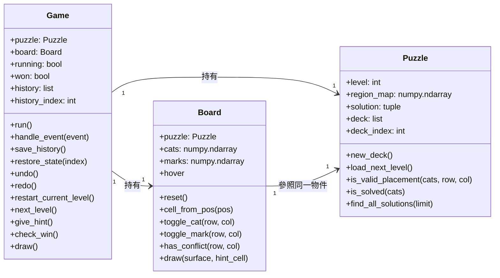

# Cat Puzzle — UML 類別圖

本文件根據公開 Repository `Owen7529/Python-Cat-Puzzle-Game` 的 `main` 分支中 `game.py`、`board.py`、`puzzle.py` 撰寫。圖中只列出主要屬性及方法；省略部分畫面繪製輔助方法，以維持可讀性。

## 核心 UML 類別圖

> 圖中 `+` 表示公開介面。Python 沒有 Java 式的存取修飾子；此處用 UML 的公開符號表示一般可存取的屬性與方法，並非語言層級的存取保護。圖中的型別是根據初始化值及用途整理的文件型別，不代表原始程式已宣告型別註記。

## 類別職責

| 類別 | 程式檔案 | 職責 |
| --- | --- | --- |
| `Game` | `game.py` | 建立遊戲、接收 Pygame 事件、控制流程、提示與操作歷史 |
| `Board` | `board.py` | 保存貓咪及 X 記號矩陣、處理格子座標與棋盤繪製 |
| `Puzzle` | `puzzle.py` | 載入與安排關卡、保存答案、檢查放置規則及通關狀態 |

## 執行與資料流

1. `main.py` 建立 `Game()`，呼叫 `run()`。
2. `Game` 建立一個 `Puzzle`，再將它傳給 `Board`，因此兩者參照同一個關卡物件。
3. `Game.handle_event()` 接收使用者操作，依需求更新 `Board` 的棋盤狀態。
4. `Puzzle` 提供合法放置與通關判斷。
5. `Game` 維護操作歷史，並要求各物件更新畫面。

## 不納入類別圖的模組

- `level_diversity.py`：提供關卡旋轉、鏡射及結構差異比較的函式，並非本圖中的類別。
- `tools/generate_levels.py`：離線產生與驗證關卡，不屬於遊戲執行時的三個核心物件。
- `config.py`、`ui.py`：設定與輔助功能模組，不應誤畫成不存在的類別。

這張 UML 圖描述的是**核心物件關係**，不是全部函式呼叫圖，也不代表執行時會即時產生關卡。
